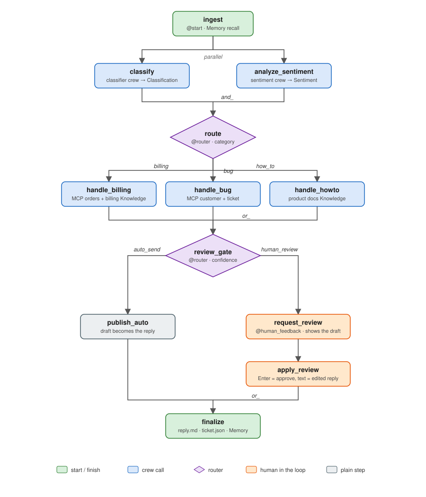

# 02 - Support Ticket Triage Flow

## 1. What the project does

An event-driven **Flow** that triages incoming support tickets:

1. Ingests a ticket (JSON file, see `data/tickets/`).
2. A classifier crew labels it `billing`, `bug` or `how-to` and returns a confidence score.
3. A router sends it to the matching specialist crew. Each specialist answers using product docs (RAG) and ticket data from an **MCP server**.
4. Low confidence (< `CONFIDENCE_THRESHOLD`) pauses the flow and asks a human to approve the draft (Enter) or type a corrected reply.
5. Memory recognises repeat customers and reuses earlier context.



Sample tickets: `billing_01`, `bug_01`, `howto_01` and `unclear_01` (vague, so it triggers the human review).

Output per ticket: `output/<ticket-id>/reply.md` and `output/<ticket-id>/ticket.json` (the final flow state).

## 2. CrewAI aspects covered

| Aspect | Where |
|---|---|
| **Flows**: `@start`, `@listen`, `@router`, `and_` / `or_` | `src/triage_flow/flow.py` |
| Typed Flow state (Pydantic `BaseModel`) | `TicketState` in `flow.py` |
| Crews embedded in Flow steps, agents/tasks in YAML | `crews.py`, `config/*.yaml`: classifier, sentiment, 3 specialists |
| Parallel branches | sentiment + classification run concurrently |
| **MCP tools** (`MCPServerStdio`, static tool filter per specialist) | `mcp_server.py` (FastMCP server), `crews.py` |
| **Knowledge** (RAG over `knowledge/*.md`, Ollama embedder) | billing and how-to specialists |
| **Memory** (unified `Memory` class, per-customer scope) | `self.recall` / `self.remember` in `flow.py` |
| Human-in-the-loop (`@human_feedback` with a custom provider) | low-confidence review step |
| Structured output (`output_pydantic`) | `models.py`: classification, sentiment |
| Flow persistence (`@persist`, SQLite in `db/`) | state of every ticket run |
| Flow plot (`flow.plot()`) | `triage_flow_plot` |
| Claude / local LLM switch (native providers) | `llm_factory.py` |
| Offline tests with a stub LLM | `tests/` |

The MCP server is written in Python (FastMCP) so the project runs without extra tooling. Tools: `get_ticket`, `get_customer`, `search_orders`. Because you work with Spring Boot, the same three tools could be served by a Spring AI MCP server instead; only `ticket_mcp_server()` in `crews.py` would change (a `MCPServerHTTP` URL).

## 3. Prepare, build, run

This project is a member of the **uv workspace** in the repository root: one shared `.venv` and one `uv.lock` for all three projects. For first-time setup on a new computer (installing uv, Ollama, cloning) see the [root README](../README.md#setting-up-on-another-computer).

Requirements: [uv](https://docs.astral.sh/uv/) (it downloads Python 3.12 automatically, pinned by the root `.python-version`; CrewAI 1.15.x does not support Python 3.14), and an Anthropic API key **or** Ollama.

### Install dependencies

Run `uv sync` once from the **repository root**, then create this project's `.env`.

**Windows (PowerShell)**
```powershell
cd <repo-root>
uv sync                                  # or: uv sync --package support-ticket-triage-flow
cd 02-support-ticket-triage-flow
Copy-Item .env.example .env
```

**Linux / macOS**
```bash
cd <repo-root>
uv sync                                  # or: uv sync --package support-ticket-triage-flow
cd 02-support-ticket-triage-flow
cp .env.example .env
```

No manual activation is needed; prefix commands with `uv run`. To activate the shared environment anyway: `..\.venv\Scripts\Activate.ps1` (Windows) or `source ../.venv/bin/activate` (Linux).

### Choose the LLM and embeddings (edit `.env`)

Claude (`LLM_PROVIDER=claude`, set `ANTHROPIC_API_KEY`). Claude has no embedding model, so Memory and Knowledge always use a local embedder:

```bash
ollama pull mxbai-embed-large     # embeddings for Memory / Knowledge
ollama pull qwen3.5:9b            # or qwen3:4b .  local LLM (~6.6 GB, fits 8 GB VRAM)
```

Local (`LLM_PROVIDER=local`): start Ollama with a larger context:

- Windows: `$env:OLLAMA_CONTEXT_LENGTH=16384; ollama serve`
- Linux: `OLLAMA_CONTEXT_LENGTH=16384 ollama serve`

### Run

From `02-support-ticket-triage-flow/`:
```bash
uv run triage_flow_kickoff                                # all tickets in data/tickets/
uv run triage_flow_kickoff --ticket data/tickets/billing_01.json
uv run triage_flow_kickoff --auto                         # approve low-confidence drafts without asking
uv run triage_flow_plot                                   # prints the path of the flow diagram HTML
```

Run from `02-support-ticket-triage-flow/` (knowledge files are read from `./knowledge`). The MCP server is started automatically over stdio by the specialists; to run it by hand: `uv run python -m triage_flow.mcp_server`.

Settings in `.env` (see `.env.example`): `LLM_PROVIDER`, `CONFIDENCE_THRESHOLD`, `HITL_MODE` (`console`|`auto`), and switches `USE_MCP`, `USE_KNOWLEDGE`, `USE_MEMORY` (set `false` to run without Ollama embeddings or the MCP subprocess).

### Tests (offline, no API key, no Ollama)

```bash
uv run --package support-ticket-triage-flow pytest 02-support-ticket-triage-flow/tests   # from the repo root
```

> `crewai flow kickoff` / `crewai run` are not used: they call fixed script names that would collide between the workspace projects, so this project has its own `triage_flow_*` scripts.

> Use Claude for the classifier/router if the local model misclassifies; routing quality depends heavily on structured-output reliability.
