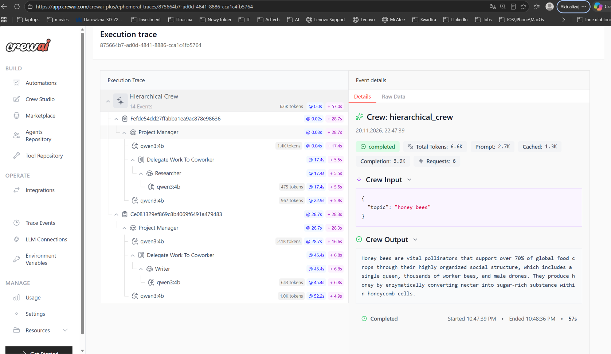

# 04 - Hierarchical process and delegation

## 1. What the project does

The smallest possible demo of CrewAI's **hierarchical process**. A manager agent gets two tasks and decides which worker does each one. The tasks have no agent assigned in code.

- **Researcher**: collects three facts about a topic.
- **Writer**: turns the facts into a two-sentence summary.
- **Project Manager** (not in the crew's `agents` list): delegates each task to a worker.

`--process sequential` runs the same tasks with agents assigned by hand, for comparison.

## 2. CrewAI aspects covered

| Aspect | Where |
|---|---|
| `Process.hierarchical` with `manager_agent` | `crew.py` |
| Delegation (`allow_delegation=True` gives the manager the delegate / ask-coworker tools) | `crew.py` |
| Tasks without an agent (the manager picks) vs. tasks with an agent (sequential) | `crew.py` |
| Event listener that records each delegation | `listeners.py` |
| Claude / local LLM switch (native providers) | `llm_factory.py` |
| Offline test with a stub LLM that plays the manager | `tests/test_crew.py` |

Things worth knowing:

- In a hierarchical crew every `TaskOutput.agent` is the **manager**, not the worker. Which worker did what is visible only through the delegation tool calls, which is why `listeners.py` exists.
- The finished-tool event reports the snake_case name `delegate_work_to_coworker`, the started event the display name `Delegate work to coworker`.
- A small local model such as `qwen3:4b` may skip delegation and do the work itself. The output then says "no delegation happened". A larger model (or Claude) delegates more reliably.

## 3. Prepare, build, run

This project is a member of the **uv workspace** in the repository root (one shared `.venv` and `uv.lock`). First-time setup on a new computer: see the [root README](../README.md#setting-up-on-another-computer).

```bash
cd <repo-root>
uv sync
cd 04-hierarchical-delegation
cp .env.example .env          # Windows: Copy-Item .env.example .env
```

Choose the LLM in `.env`: `LLM_PROVIDER=claude` with `ANTHROPIC_API_KEY` (or the same OS environment variable), or `LLM_PROVIDER=local` with `ollama pull qwen3:4b` (2.5 GB, a small model that is good enough for this demo).

Run, from `04-hierarchical-delegation/`:

```bash
uv run hierarchical_run --topic "honey bees"
uv run hierarchical_run --topic "honey bees" --process both     # hierarchical, then sequential
```

Tests (offline, no model needed), from the repository root:

```bash
uv run --package hierarchical-delegation pytest 04-hierarchical-delegation/tests
```

## Execution example

```bash
uv run hierarchical_run --topic "honey bees"
```

Output:

```
Share this execution trace with CrewAI? [y/N] (20s timeout): y
╭──────────────────────────────────────────── 🔗 Ephemeral Execution Traces ─────────────────────────────────────────────╮
│                                                                                                                         │
│  View traces: https://app.crewai.com/crewai_plus/ephemeral_traces/875664b7-ad0d-4841-8886-cca1c4fb5764                  │
│                                                                                                                         │
╰─────────────────────────────────────────────────────────────────────────────────────────────────────────────────────────╯

=== hierarchical ===
delegations made by the manager:
  -> Researcher: Collect three key facts about honey bees
  -> Writer: Write a two-sentence summary of honey bees using the facts from the research.

result:
Honey bees are vital pollinators that support over 70% of global food crops through their highly organized social structure, which includes a single queen, thousands of worker bees, and male drones. They produce honey by enzymatically converting nectar into sugar-rich substance within honeycomb cells.
```

## CrewAI Ephemeral Execution Traces

After a run CrewAI can offer to share the execution trace. If you answer `y` at the prompt, the trace is published on the CrewAI site (app.crewai.com) and a link to it is printed:

The trace then lives on the CrewAI site, so only share runs that contain nothing private. Answer `n` (or wait for the 20 s timeout) to keep it local.


